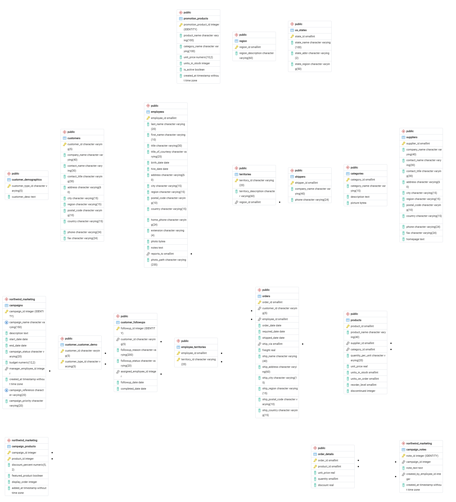

# Northwind Database Expansion: Marketing & CRM Architecture

## Project Overview
This project expands the classic **Northwind** relational database in **PostgreSQL 18** by designing and implementing a dedicated `northwind_marketing` schema and customer relationship management (CRM) tracking tables. The goal of this architecture is to enable marketing teams to plan promotional campaigns, track product discounts, manage customer follow-ups, and generate real-time reporting without altering core order-processing tables.

## Database Architecture & Custom Objects

### 1. `northwind_marketing` Schema
Created a separate schema to isolate marketing campaign logic from core `public` sales tables while maintaining cross-schema foreign key integrity.
* **`campaigns`**: Tracks campaign lifecycles (`Planned`, `Active`, `Completed`, `Canceled`), priority levels (`Low` to `Critical`), budgets, date ranges, and assigned employee managers.
* **`campaign_products`**: Junction table linking campaigns to `public.products`, storing product-specific discount percentages, featured product flags, and display ordering.
* **`campaign_notes`**: Audit log allowing employees to record timestamped review notes and approvals per campaign.
* **Sequences & Indexing**: Implemented `campaign_reference_seq` for standardized campaign tracking codes (e.g., `CMP-1000`) and a B-tree index (`idx_campaigns_status`) to optimize status filtering.

### 2. Core `public` Schema Extensions
* **`customer_followups`**: Tracks post-sale customer outreach (`Pending`, `In Progress`, `Completed`, `Canceled`), linking customers to assigned sales representatives and completion dates.
* **`promotion_products`**: Manages standalone promotional merchandise inventory, pricing, and active status flags.

### 3. Reporting Views & Materialized Views
* **`active_campaign_products` (View)**: Joins active campaigns with product pricing to dynamically calculate promotional sale prices (`current_product_price * (1 - discount_percent / 100)`).
* **`campaign_summary` (View)**: Uses Common Table Expressions (CTEs) to aggregate product counts, average discount percentages, and note totals per campaign alongside manager names.
* **`campaign_product_statistics` (Materialized View)**: Pre-computes campaign performance metrics—including total products, featured item counts, and min/max/average discounts—for fast executive reporting.

## Data Integrity & Validation Rules
To prevent invalid business data at the database level, the schema enforces:
* **Check Constraints**: Validates non-negative budgets and prices, ensures `end_date >= start_date`, restricts discount percentages between `0` and `100`, and enforces strict status/priority domain lists.
* **Referential Integrity**: Enforces foreign key constraints across schemas (linking campaigns and follow-ups to `public.employees`, `public.customers`, and `public.products`) with `ON DELETE CASCADE` rules on dependent campaign notes.

## Repository Contents
* `northwinds_backup.sql` — Complete PostgreSQL 18 plain-text database dump including custom schemas, tables, views, constraints, and sample records.

## How to Run This Project
1. Open **pgAdmin 4** (or `psql`) connected to a **PostgreSQL 18** server.
2. Create a new empty database named `northwinds`.
3. Restore or execute the `northwinds_backup.sql` script to build the `public` and `northwind_marketing` schemas and populate the data.
4. Query `SELECT * FROM northwind_marketing.campaign_summary;` to view the aggregated campaign report.

###ERD

